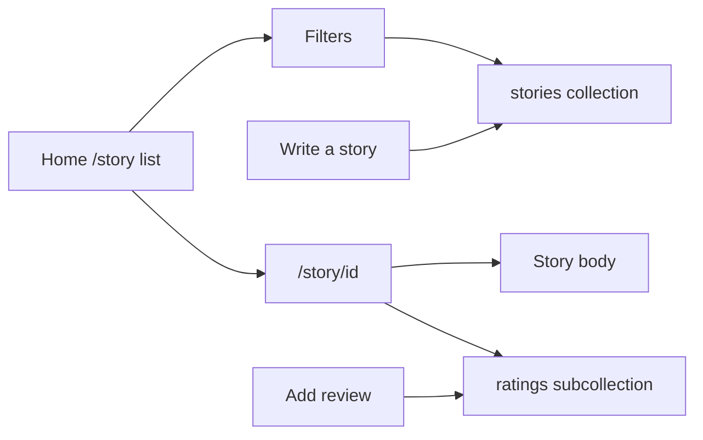

# Convert Friendly Eats into a story review site

The app already has the right shape: list + filters, detail page, star ratings, Gemini review summary, image upload, and sample-data seeding. The work is a **domain remap** plus one real new feature: **authors publish a story body**, not just a named listing.

## Domain mapping

Keep the same filter/index pattern so Firestore queries stay simple:

- `name` → `title`
- `category` (cuisine) → `genre` (Fantasy, Sci-Fi, Mystery, Romance, Horror, Literary, Historical, Slice of Life)
- `city` → `author` (display name of the writer)
- `price` (1–4 `$`) → `length` (1–4: Flash / Short / Medium / Long), derived from word count of `body`
- **New:** `body` (story text), `authorId` (Firebase uid)
- Keep: `photo`, `avgRating`, `numRatings`, `sumRating`, `timestamp`
- Keep ratings subcollection: `stories/{storyId}/ratings`

Brand copy: **Friendly Tales** (header, `metadata` in [src/app/layout.js](src/app/layout.js)).

## Data, rules, and indexes

**Firestore collection** `restaurants` → `stories` in [src/lib/firebase/firestore.js](src/lib/firebase/firestore.js), [firestore.rules](firestore.rules), [firestore.indexes.json](firestore.indexes.json).

Rename helpers in place (same files, new names): `getStories`, `getStoryById`, `getStoriesSnapshot`, `getStorySnapshotById`, `addReviewToStory`, `updateStoryImageReference`, `addFakeStoriesAndReviews`.

Update [firestore.indexes.json](firestore.indexes.json) composite indexes: `collectionGroup: stories`, field paths `genre`, `author`, `length` (same combinations as today’s `category` / `city` / `price`).

**Rules** in [firestore.rules](firestore.rules):

- `match /stories/{storyId}`: read public; create if signed in and `authorId == request.auth.uid`
- Updates for rating aggregates / cover: signed-in, and `title`, `body`, `authorId` unchanged (same idea as today’s `unchanged("name")`)
- Author may also update their own `title` / `body` / `photo`
- `ratings` create still requires auth; store `userId` from the server action, not the client

After deploy, re-seed: old `restaurants` docs will not show up.

## Sample data and filters

Replace [src/lib/randomData.js](src/lib/randomData.js) and rename [src/lib/fakeRestaurants.js](src/lib/fakeRestaurants.js) → `fakeStories.js`:

- Story titles, short `body` paragraphs, genres, fake authors, reviews about writing/plot (not food)
- Cover URLs: stop using `food_*.png`; use a generic placeholder (e.g. picsum or a static `/cover-placeholder.svg`)
- Header item “Add sample stories” in [src/components/Header.jsx](src/components/Header.jsx)

[src/components/Filters.jsx](src/components/Filters.jsx): labels **Genre / Author / Length / Sort**; query params `genre`, `author`, `length`. Length options Flash–Long instead of `$`–`$$$$`. [src/lib/firebase/firestore.js](src/lib/firebase/firestore.js) `applyQueryFilters` should match `length` as an integer (today `price.length` counts `$` characters — switch to a numeric value or a dedicated encoding).

## Routes and components (full rename)

| Today                                                                                                           | After                                                 |
| --------------------------------------------------------------------------------------------------------------- | ----------------------------------------------------- |
| [src/app/restaurant/[id]/](src/app/restaurant/[id]/page.jsx)                                                    | `src/app/story/[id]/` (move `page.jsx` + `error.jsx`) |
| [RestaurantListings.jsx](src/components/RestaurantListings.jsx)                                                 | `StoryListings.jsx`, links to `/story/{id}`           |
| [Restaurant.jsx](src/components/Restaurant.jsx) / [RestaurantDetails.jsx](src/components/RestaurantDetails.jsx) | `Story.jsx` / `StoryDetails.jsx`                      |
| [storage.js](src/lib/firebase/storage.js) `updateRestaurantImage`                                               | `updateStoryImage`                                    |

CSS in [src/app/styles.css](src/app/styles.css): `.restaurants` / `.restaurant__*` / `.main__restaurant` → story equivalents. Listing cards show **title, genre, author, length**, not `$`.

**Detail page:** render `body` as the main content (whitespace-preserving), then Gemini summary + reviews. Empty-state copy in [ReviewsListClient.jsx](src/components/Reviews/ReviewsListClient.jsx): “This story has not been reviewed yet…”. Gemini prompt in [ReviewSummary.jsx](src/components/Reviews/ReviewSummary.jsx): summarize what readers think of **the story** (plot, prose, pacing), not a restaurant.

[src/app/actions.js](src/app/actions.js): hidden field `storyId`; keep using `currentUser.uid` for review `userId`.

## New: write a story

Restaurants were only seeded from the header. User-written stories need a create path.

- Signed-in header action **Write a story** (alongside sample data)
- Dialog/form: title, genre, body (textarea), optional cover later via existing upload on the detail page
- Server action `handleStoryFormSubmission`: `addDoc` to `stories` with `author`/`authorId` from the authenticated user, `length` from word count, default ratings `0`, placeholder `photo`
- Redirect to `/story/{id}` after create

Do **not** let the client pick `authorId`.

## What stays the same

Auth ([auth.js](src/lib/firebase/auth.js), [Header.jsx](src/components/Header.jsx) Google sign-in), review dialog + `RatingPicker`, live `onSnapshot` listings/reviews, Gemini summary wiring, Firebase emulator workflow.

## Verify

- Sign in → Write a story → detail shows body, author, genre
- Add a review; list/detail averages update
- Filters by genre/author/length/sort via URL params
- Add sample stories
- Gemini sentence is about the story
- Old `/restaurant/...` URLs gone

